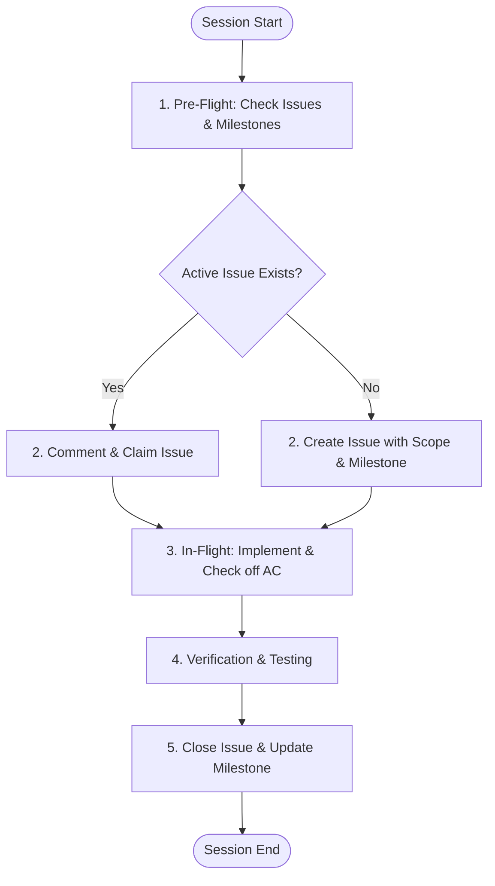

# GitHub Issues & Milestones Protocol for AI Dev Agents (`GITHUB_ISSUES_GUIDE.md`)

This guide defines the mandatory protocol for AI dev agents working on this project. When starting a chat session, the agent must adhere to this workflow to maintain a clean, disciplined, and audit-ready project management lifecycle on GitHub.

---

## 1. Core Principles

1. **No Code Without an Issue:** No feature, refactoring, or bug fix may begin without an open, assigned GitHub Issue.
2. **Deterministic Tracking:** Every code modification must link back to an Issue number (e.g., `#123`).
3. **Milestone Integrity:** Every issue must belong to a defined Milestone. When the milestone's scope shifts or completes, its status must be updated immediately.
4. **Single Source of Truth:** Technical decisions, blockers, architectural pivots, and acceptance verification must be recorded on the issue thread, not lost in chat history.

---

## 2. Session Lifecycle Checklist



---

## 3. Step-by-Step Agent Execution Rules

### Step 1: Pre-Flight Check (Start of Session)
Before writing or proposing code:
1. **Query Existing Issues:**
   * Run `list_issues` or `search_issues` to see open work items in the repository.
   * Search specifically for tasks matching the user's prompt.
2. **Check Current Milestone:**
   * Identify the target milestone for the sprint/cycle.
3. **Confirm Scope:**
   * If an issue exists: Confirm with the user that this is the active issue to work on.
   * If no issue exists: Formulate a draft issue title, description, and acceptance criteria.

---

### Step 2: Issue Creation Standard

When creating an issue, use the following structure:

#### Title Format
```text
[<Type>] <Concise summary in imperative mood>
```
* **Types:** `[Feature]`, `[Bug]`, `[Refactor]`, `[Security]`, `[Chore]`, `[Docs]`, `[Test]`
* *Example:* `[Feature] Implement JWT token validation middleware`
* *Example:* `[Bug] Fix null pointer on unauthenticated webhook callback`

#### Issue Body Template
```markdown
## Context & Problem
<!-- Brief description of why this change is needed and what problem it solves. -->

## Scope of Work
<!-- Bulleted list of what will be implemented or modified. -->
- [ ] Implement ...
- [ ] Add unit tests for ...
- [ ] Update documentation / types ...

## Acceptance Criteria
<!-- Verifiable conditions required before this issue can be closed. -->
- [ ] AC 1: All tests pass for the new component.
- [ ] AC 2: Error states return structured JSON responses.
- [ ] AC 3: No regressions introduced in related modules.

## Technical Details / Affected Files
- Target files/directories: `src/...`
- Dependencies: ...
```

#### Metadata Requirements
* **Labels:** Apply at least one type label (`bug`, `enhancement`, `security`, `documentation`) and priority if applicable.
* **Milestone:** Assign to the current active milestone.
* **Assignee:** Assign to the responsible user or agent identity (`@me`).

---

### Step 3: In-Flight Progress Updates

For tasks requiring multiple steps, substantial edits, or unexpected pivots:
1. **Progress Comments:** Post incremental updates on the issue if a major phase is completed:
   ```markdown
   > **Progress Update**: Core service logic implemented in `src/services/auth.ts`. Moving to integration tests.
   ```
2. **Blockers & Scope Changes:** If an unexpected obstacle arises or the scope must change:
   * Pause code changes.
   * Document the blocker or architectural decision directly on the issue.
   * Await user confirmation before expanding scope.

---

### Step 4: Verification & Closure Standard

Never close an issue based solely on writing code. Follow this closing checklist:

1. **Verify Acceptance Criteria:** Every checkbox in the issue's Acceptance Criteria must be met.
2. **Verify Code Quality:**
   * Linting and type-checks must pass without errors.
   * Relevant tests must be executed and confirmed passing.
3. **Closing Comment Format:**
   Post a final summary comment on the issue before closing:
   ```markdown
   ### Resolution Summary
   - **Implemented:** <Concise summary of changes>
   - **Key Files Modified:**
     - `path/to/fileA.ts`
     - `path/to/fileB.ts`
   - **Verification:** All acceptance criteria satisfied and test suite passed.
   - **Related Commits/PRs:** <commit hash or PR link>
   ```
4. **Close Issue:** Mark the issue as `closed` (`state_reason: completed`).

---

### Step 5: Milestone Maintenance

1. **Progress Check:** After closing an issue, check the remaining open issues under the milestone.
2. **Milestone Completion:** If all issues assigned to the milestone are closed:
   * Alert the user that the milestone objectives are achieved.
   * Provide a concise milestone recap report.
3. **Rollover:** If an issue cannot be completed within the milestone window, explicitly discuss moving it to the next milestone with the user.

---

## 4. GitHub MCP Tool Reference Cheat Sheet

When operating with the GitHub MCP server, use the corresponding tools:

| Action | GitHub MCP Tool | Key Arguments |
| :--- | :--- | :--- |
| **Search/Find Issues** | `search_issues` | `query`, `owner`, `repo`, `sort` |
| **List Issues** | `list_issues` | `owner`, `repo`, `milestone`, `state` |
| **Read Issue Details** | `issue_read` | `owner`, `repo`, `issue_number` |
| **Create New Issue** | `issue_write` (method: create) | `owner`, `repo`, `title`, `body`, `labels`, `milestone` |
| **Add Comment** | `add_issue_comment` | `owner`, `repo`, `issue_number`, `body` |
| **Update / Close Issue** | `issue_write` (method: update) | `owner`, `repo`, `issue_number`, `state: "closed"` |
| **Check Branches** | `list_branches` | `owner`, `repo` |
| **Create PR** | `create_pull_request` | `owner`, `repo`, `title`, `head`, `base`, `body` |

---

## 5. Agent System Prompt Snippet (Quick Inject)

*Copy and paste this snippet at the beginning of any AI agent prompt to enforce this protocol:*

> **Directive for AI Agent:**
> Follow the rules defined in `GITHUB_ISSUES_GUIDE.md`:
> 1. Do not begin coding without an open GitHub Issue linked to the task.
> 2. Query open issues and active milestones using GitHub MCP before starting.
> 3. If no issue exists, draft and create one following the standard format (Context, Scope, Acceptance Criteria, Milestone).
> 4. Check off acceptance criteria and post a structured resolution comment before closing the issue.
